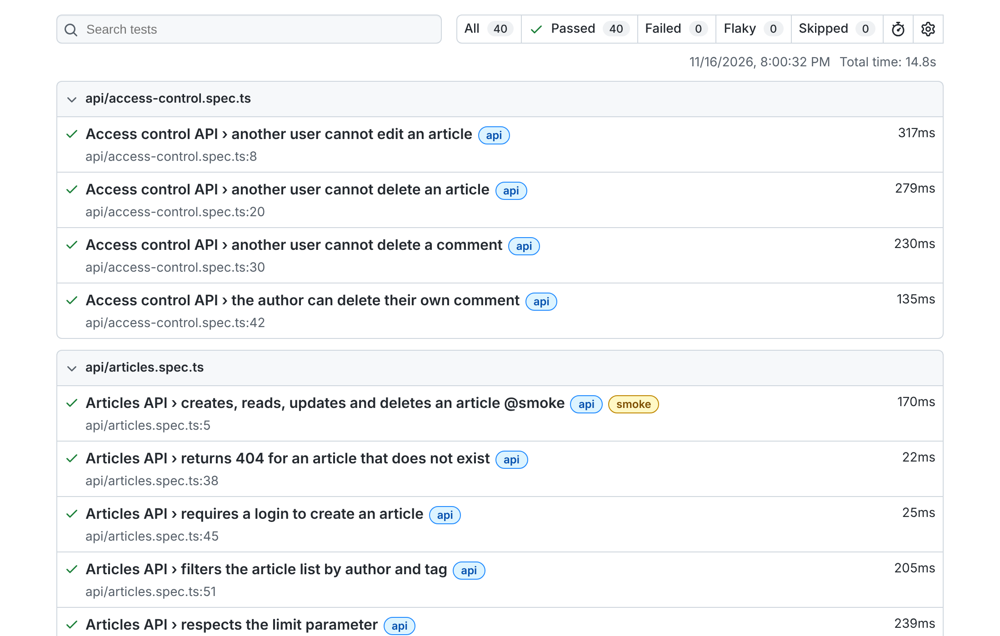

# Conduit – Playwright UI & API tests

<!-- After your first push, replace sfvcode below so the badge works. -->
[](https://github.com/sfvcode/conduit-playwright-tests/actions/workflows/tests.yml)

Automated UI and API tests for **Conduit**, the [RealWorld](https://github.com/gothinkster/realworld)
example app (a Medium-style blog with sign-up, login, articles, comments and tags).
Built with **Playwright** and **TypeScript**, and run on every push with **GitHub Actions**.

**Latest test report:** https://sfvcode.github.io/conduit-playwright-tests/



## What is tested

| Area | API tests | UI tests |
|---|---|---|
| Sign-up and login | Success, wrong password, duplicate email, missing fields | Sign up, log in, wrong password, duplicate email, log out |
| Tokens | Valid token, missing token, invalid token | – |
| Articles | Create, read, update, delete, 404, login required, filters, limit, favorites | Publish, Markdown rendering, edit, delete |
| Access control | Other users can't edit or delete articles or comments | Other users don't see edit/delete buttons |
| Comments | Add, list, delete | Add and delete, logged-out visitors can't comment |
| Tags | – | Sidebar matches the API, filtering by tag |

**40 tests**: API tests run without a browser; UI tests run in desktop Chrome,
and the most important ones (tagged `@mobile`) also run on a Pixel 7 screen.

## Bugs found

While writing the tests I found two bugs in the app. Each one has a write-up
with steps to reproduce, and a test that is marked as an expected failure
until the bug is fixed:

- [001 – An invalid token returns 500 instead of 401](docs/findings/001-invalid-token-returns-500.md)
- [002 – `articlesCount` counts tags, not articles](docs/findings/002-articles-count-includes-tags.md)

## How the tests are built

- **Page Object Model.** Each page has a class in `src/pages/` with its locators
  and actions. Tests describe *what* happens; page objects know *how*.
- **User-facing locators.** Roles, labels and placeholders (`getByRole`, `getByPlaceholder`)
  rather than CSS paths, so tests survive styling changes.
- **API for setup, UI for checking.** Most UI tests create their users and articles
  through the API first. This is faster and more stable than clicking through setup screens.
  Some tests also check the result through the API after a UI action.
- **Login without the login form.** The `loginAs` fixture puts the session into
  the browser's storage before the page loads. Only the login tests use the form.
- **Isolated test data.** Every test creates its own users and articles with unique names,
  so tests run in parallel and don't depend on each other. Articles are deleted after each test.
- **No fixed waits.** Only Playwright's auto-waiting and web-first assertions.
- **Known bugs stay visible.** `test.fail()` marks a test that fails because of a known bug.
  When the bug is fixed, the test passes unexpectedly and the run fails, which is the signal to retest.

## Project structure

```
.github/workflows/tests.yml   CI: database, app, tests, report on GitHub Pages
docs/findings/                Bug reports with steps to reproduce
scripts/                      Download, build and start the app under test
src/
  api/ConduitApi.ts           Small client for the REST API
  data/factories.ts           Builders for unique test users and articles
  fixtures/index.ts           Custom fixtures: api, user, createArticle, loginAs, page objects
  pages/                      Page objects
tests/
  api/                        API tests (no browser)
  ui/                         UI tests
playwright.config.ts          Projects: api, chromium, mobile-chrome
docker-compose.yml            Local Postgres database
```

## Run the tests on your machine

You need **Node.js 20+**, **Git** and **Docker** (for the database).

```sh
git clone https://github.com/sfvcode/conduit-playwright-tests.git
cd conduit-playwright-tests
npm install
npx playwright install chromium
cp .env.example .env

npm run db:up        # start Postgres in Docker
npm run app:setup    # download and build the Conduit app (first time only)
npm test             # Playwright starts the app and runs all tests
npm run report       # open the HTML report
```

Other useful commands:

| Command | What it does |
|---|---|
| `npm run test:api` | API tests only |
| `npm run test:ui` | UI tests in desktop Chrome |
| `npm run test:mobile` | Mobile tests on a Pixel 7 screen |
| `npm run test:smoke` | Only the tests tagged `@smoke` |
| `npm run test:headed` | Watch the browser while tests run |
| `npm run test:watch` | Playwright's UI mode |
| `npm run db:down` | Stop the database |

## The app under test

The app is [TonyMckes/conduit-realworld-example-app](https://github.com/TonyMckes/conduit-realworld-example-app)
(React, Express, PostgreSQL, MIT licence), pinned to one commit in `scripts/setup-app.sh`
so test results don't change when the app's repository changes.
It runs in production mode, so one server on port 3001 serves both the website and the API.
